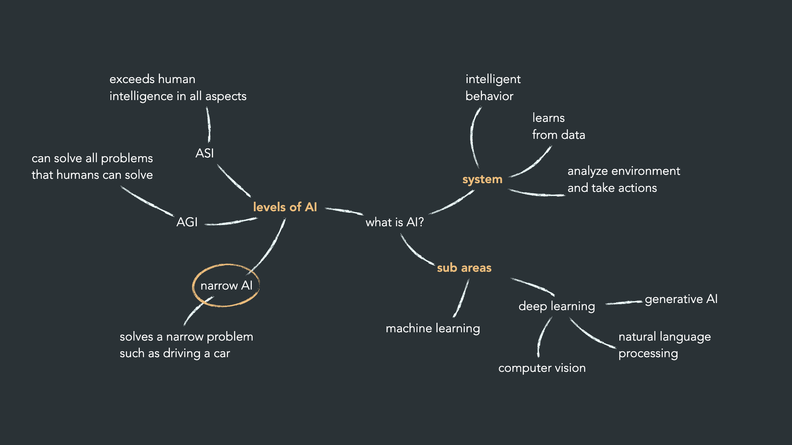
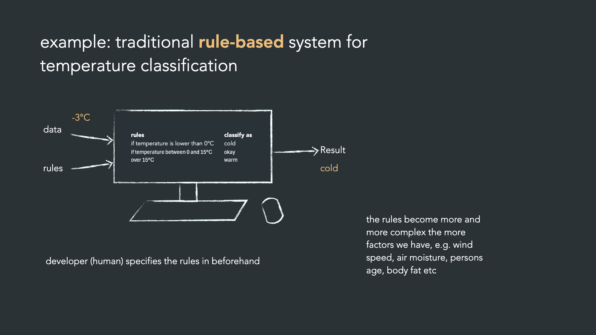
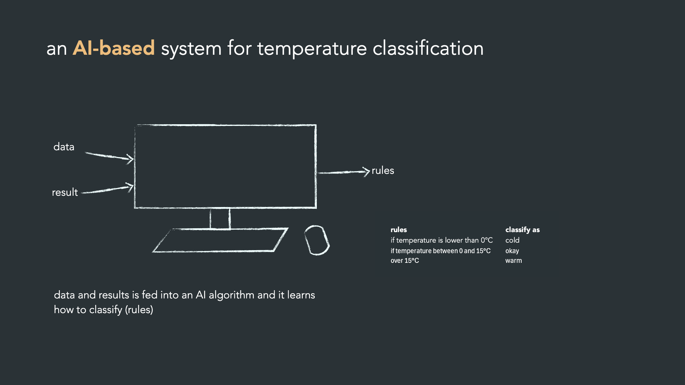
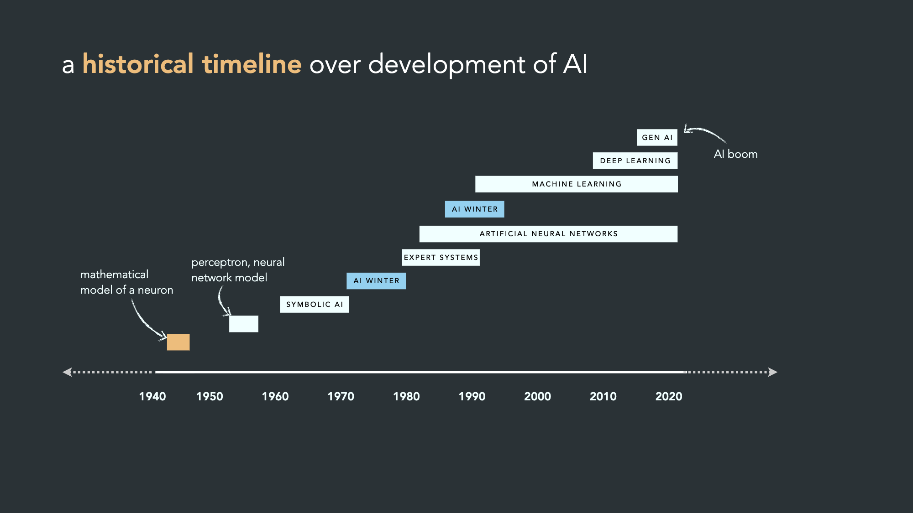

# En mild introduktion till AI

## Vad är AI?

- **Exempel på AI-tillämpningar:** MRI-segmentering, chatbots, spamfilter, ansiktsigenkänning i mobilen, musikrekommendationer, riktad annonsering och designförslag i PowerPoint.
- **Generativ AI:** skapar bilder och text. Slidesen visar bilder genererade med flux.1 schnell och DALL-E 3 samt en quiz där man ska hitta "Bella" och "Sammi" bland AI-genererade bilder.
- **Definition (från ChatGPT 4.5):** simulering av mänsklig intelligens med lärande, resonemang, perception, språkförståelse och beslutsfattande.

## Nivåer och delområden

- **Narrow AI** löser ett smalt problem, t.ex. att köra bil. **Dagens system finns här.**
- **AGI** kan lösa alla problem som människor kan.
- **ASI** överträffar människan på alla områden.
- **Delområden:** machine learning, deep learning, computer vision, NLP och generativ AI.

## Regelbaserat vs. AI-baserat

- **Traditionellt:** utvecklaren skriver reglerna i förväg (t.ex. -3 °C ger "kallt"). Reglerna blir snabbt komplexa med fler faktorer.

  

- **AI-baserat:** data och facit matas in i en algoritm som själv lär sig reglerna.

  

## Historik

- **1940–60-tal:** matematisk modell av en neuron, perceptron och symbolisk AI.
- **1970–80-tal:** expertsystem, med två AI-vintrar.
- **1980–90-tal:** artificiella neurala nätverk och machine learning, där statistiska metoder blomstrade och fortfarande används mycket.
- **2010-talet:** deep learning slog igenom tack vare enorma datamängder och GPU-kraft, med framgångar inom computer vision.
- **2020-talet:** AI-boom med generativ AI och LLM:er.
- Neurala nätverk är **inspirerade av** hjärnan, inte en modell av den.

## Att driva ett AI-projekt

- **Data är nyckeln:** rådata från verkligheten förbehandlas till strukturerad data, som används av AI i en applikation.
- **Hitta värde:**
  - Identifiera ett problem som ger värde när det löses.
  - Fråga varför AI behövs, eller om det bara görs för att konkurrenterna gör det.
  - Kan problemet lösas utan AI? Tvinga i så fall inte fram en AI-lösning.
  - Börja med lågt hängande frukt för att vinna förtroende i organisationen.
  - Samarbeta mellan domänexperter och AI-experter.
