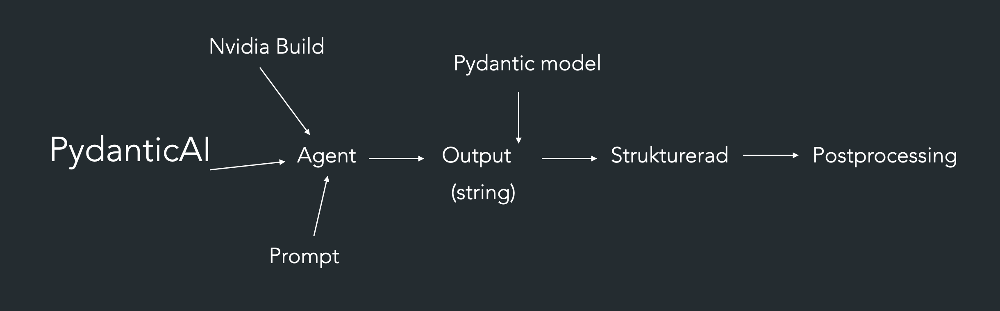
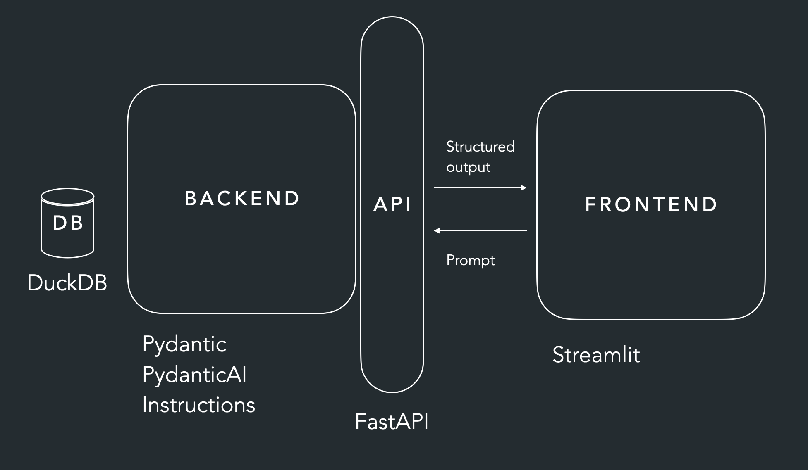

# Architecture

## Pipeline Pydancicai -> Agent -> Output -> Postprocessing:

- Pydantic AI använder vi för att vi ska kunna byta mellan exempel nvidia, gemini , openai osv..
- Pydancic model (validerings-modell) för att strukturera output från Agenten

## DB, Backend, API , frontend

- När vi gör en get requst får ci strukturerad output
- När vi postar är det en prompt

# Tops för att jobba

- Börja med endpoints för API
- jobba bakåt mot BaseModels (Pydancic models )
- för att sedan bygga upp strukturen för lagreing i databasen
