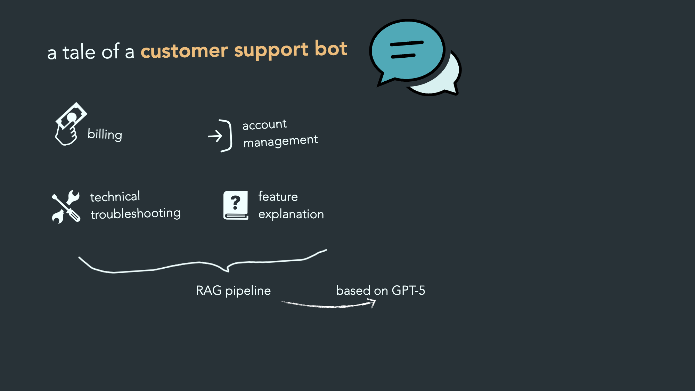
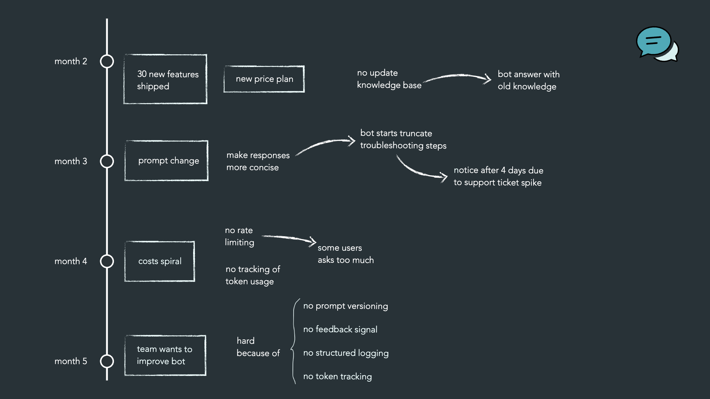
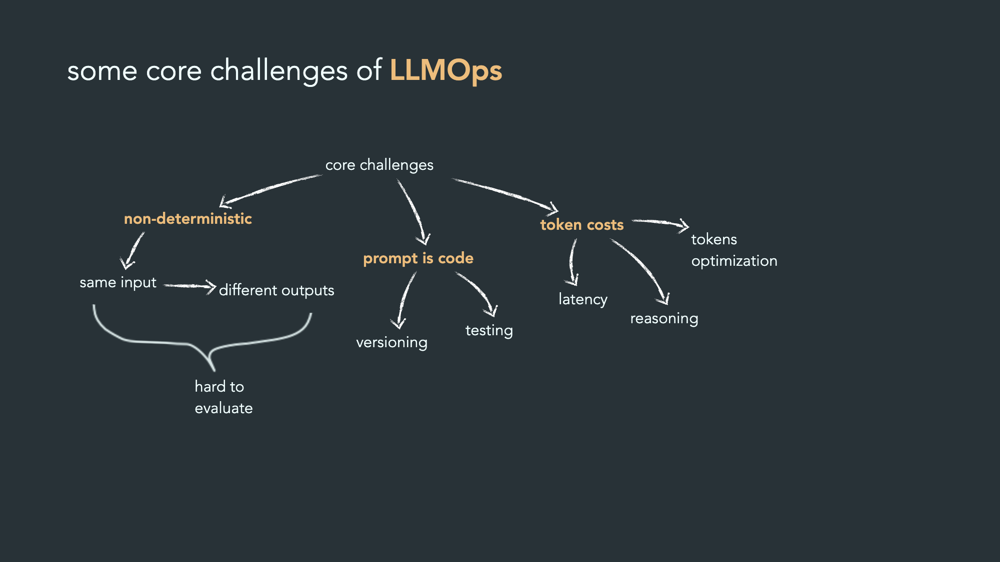

# Intro AI Ops

## Vad är LLM Ops?

LLM Ops är sättet man **sköter hela livscykeln för en AI-app som bygger på en språkmodell**: bygga, släppa, övervaka och förbättra den. Det är som MLOps, men anpassat för det som är särskilt med språkmodeller: prompts, tokenkostnader och svar som kan variera.

## Exemplet: en kundtjänst-bot med RAG

Följer en kundtjänst-bot som använder **RAG** (Retrieval-Augmented Generation).

- Boten **slår upp** relevanta dokument i en kunskapsbas.
- Den **skriver sedan ett svar** utifrån det den hittade.
- Allt fungerar bra i början. Problemen kommer smygande månad för månad.

### Månad 2 – Kunskapen blir gammal

**Vad som hände:** Företaget lanserade nya funktioner men uppdaterade inte kunskapsbasen. Boten svarade med gammal information, och kunder blev missnöjda och slutade.

**Lärdom:** Boten kan låta säker och korrekt fast svaret är föråldrat. Kunskapsbasen måste hållas aktuell och övervakas, inte bara modellen.

### Månad 3 – Ändrad prompt ger nya fel

**Vad som hände:** Någon ändrade prompten för att förbättra något. Som bieffekt började felsökningssvaren **klippas av** mitt i stegen. Eftersom prompten inte var versionshanterad var det svårt att se vad som ändrats och gå tillbaka.

**Lärdom:** Behandla prompts som kod: versionshantera dem, testa dem och ha ett sätt att snabbt rulla tillbaka.

### Månad 4 – Kostnaderna skenar

**Vad som hände:** Ingen följde hur många **tokens** som användes och det fanns inga begränsningar (rate limits). Räkningen växte utan att någon märkte det i tid.

**Lärdom:** Mät tokenanvändning per anrop, användare och funktion. Sätt gränser, budgetar och larm.

### Varför LLM:er misslyckas "tyst"

En vanlig app kraschar och ger ett felmeddelande. En språkmodell kan istället **ge ett välformulerat men fel eller sämre svar**, och ingen larmar. Kvaliteten kan också försämras över tid, till exempel när modeller uppdateras eller datan ändras (drift).

## Kärnutmaningar

- **Icke-determinism:** Samma fråga kan ge olika svar, så det räcker inte att testa en gång.
- **"Prompt is code":** En liten ändring i en prompt kan ändra beteendet lika mycket som en kodändring.
- **Svårmätt kvalitet:** Det finns sällan ett enda rätt svar att jämföra med.
- **Kostnad per token:** Varje promptändring påverkar kostnaden direkt.

## Nyckelbegrepp inom LLMOps

### Prompt engineering

- **Versioning:** Spara varje version av en prompt, som kod, så att du kan jämföra och rulla tillbaka.
- **Prompt templating:** En fast promptmall med variabler som fylls i (t.ex. kundens fråga), så att alla anrop byggs på samma sätt.

### Observability (övervakning)

- **Tracing:** Följ en fråga hela vägen: sökning, hämtade dokument, modellanrop och svar.
- **Detektera drift, hallucinationer och toxicitet:** Upptäck när svaren ändras över tid, när modellen hittar på fakta eller när innehållet blir skadligt.
- **Latency monitoring:** Mät hur lång tid svaren tar, så att appen inte blir långsam.

### Deployment (driftsättning)

- **Model routing:** Skicka enkla frågor till billiga modeller och svåra till starkare.
- **Fallback chains:** En kedja av reservmodeller som tar över om den första fallerar.
- **Semantic caching:** Återanvänd svar på _liknande_ frågor (inte bara identiska) för att spara tid och pengar.
- **Guardrails:** Spärrar som kontrollerar vad som går in i och ut ur modellen.

### Evaluation (utvärdering)

- **LLM as judge:** En annan språkmodell bedömer kvaliteten på svaren automatiskt.
- **Human-in-the-loop:** Människor granskar och rättar, särskilt i svåra eller känsliga fall.
- **Offline evals:** Test mot färdiga testfrågor innan release.
- **Online evals:** Mätning i produktion med riktiga användare och feedback.

### RAG pipelines

- **Chunking strategies:** Hur dokument delas upp i bitar. Det påverkar om rätt information hittas.
- **Vector DB management:** Underhåll av databasen där dokumentens "betydelse" lagras som vektorer.
- **Embedding model versioning:** Håll koll på vilken modell som skapade vektorerna. Byter du modell måste ofta allt göras om.
- **Monitor retrieval quality:** Mät om rätt dokument faktiskt hittas.

### Safety & governance (säkerhet och styrning)

- **PII detection:** Hitta och dölj personuppgifter.
- **Audit logging:** Logga vem som gjorde vad och vilken modell/prompt som gav vilket svar, så att allt går att granska.
- **Rate limiting:** Begränsa hur mycket som får användas, för att skydda kostnader och systemet.

## Sammanfattning och nästa steg

LLM-appar går sällan sönder med ett tydligt fel. De **blir långsamt sämre, dyrare eller osäkrare**. Därför behövs:

1. Versionshantering av prompts
2. Utvärdering före och efter release
3. Spårning och övervakning (kvalitet, drift, toxicitet)
4. Kostnadskontroll med tokenmätning och gränser
5. Skyddsräcken och loggning för säkerhet och regelefterlevnad

---

## Källor

### LLM Ops i allmänhet (prompt-versionering, tracing, observability)

- [What Is LLMOps? A Guide for AI Practitioners – MLflow](https://mlflow.org/articles/tags/llm-ops-in-ai/)
- [What is LLMOps? – PuppyGraph](https://www.puppygraph.com/learn/what-is-llmops)
- [What is LLMOps? – Azion](https://www.azion.com/en/learning/ai/what-is-llmops/)
- [LLMOps – Metavert](https://metavert.io/llmops)

### RAG-utvärdering (retrieval-kvalitet, faithfulness)

- [RAG Evaluation – Anyscale Docs](https://docs.anyscale.com/rag/evaluation)
- [RAG Evaluation Metrics – NVIDIA NeMo](https://docs.nvidia.com/nemo-platform/documentation/evaluate-models/metrics/rag-metrics)
- [RAG Evaluation Explained: Top Metrics, Tools & Blindspots – Atlan](https://atlan.com/know/how-to-evaluate-rag-systems-explained/)
- [Retrieval-Augmented Generation for NLP: A Survey – arXiv](https://arxiv.org/pdf/2407.13193)

### Kostnad, tokens och rate limits

- [Token Usage Monitoring – InsertChat](https://insertchat.com/glossary/token-usage-monitoring)
- [Rate limiting and quotas for LLM APIs – Hivenet](https://www.hivenet.com/post/llm-rate-limiting-quotas)
- [How to implement budget limits and alerts in LLM applications – Portkey](https://portkey.ai/blog/budget-limits-and-alerts-in-llm-apps)
- [Avoid Rookie Mistakes: Tips for Managing LLM Cost – Protecto](https://protecto.ai/blog/tips-for-managing-llm-cost)

### Routing, fallbacks, caching, guardrails och PII

- [AI Gateway vs API Gateway – DEV Community](https://dev.to/sahajmeet_kaur_/ai-gateway-vs-api-gateway-they-solve-different-problems-we-confused-them-for-six-months-56fe)
- [Portkey AI Gateway – produktionsfunktioner](https://portkey.ai/docs/aigw/integrations/agents/crewai)
