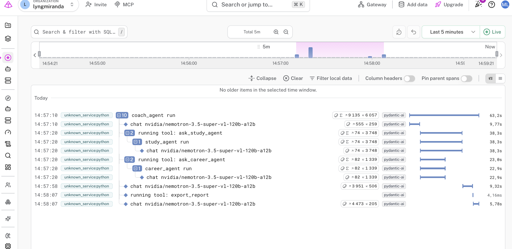

# Logfire

### Installation

```
uv add logfire

"logfire[variables]"

"logfir[system-metrics]"

```

### imports

```python
import logfire
```

### installation in code

```python
logfire.configure()
logfire.intrument_system_metrics()
logfire.instrument_fastapi/pydantic_ai
```

### Run

Authorization in terminal:

```
uv run logfire aut
```

### Run sript and initialize with y/n and enter

```
uv run main.py
```

- öppna länken för live span trace


